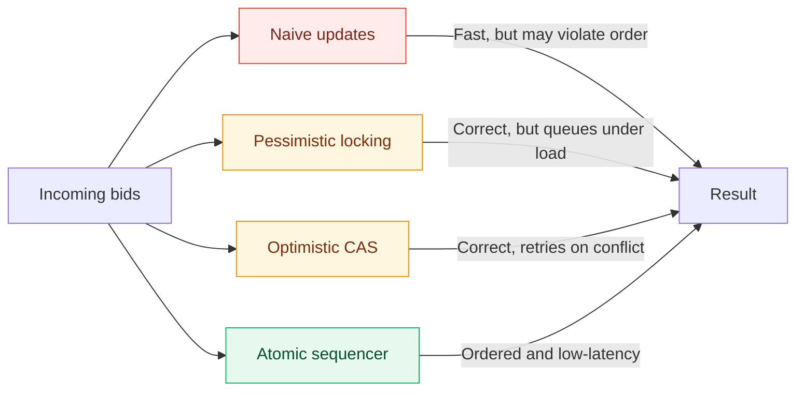
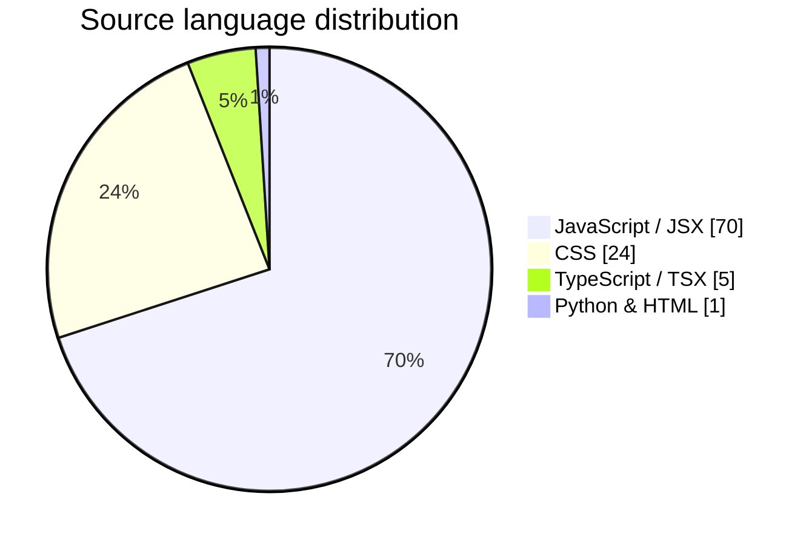
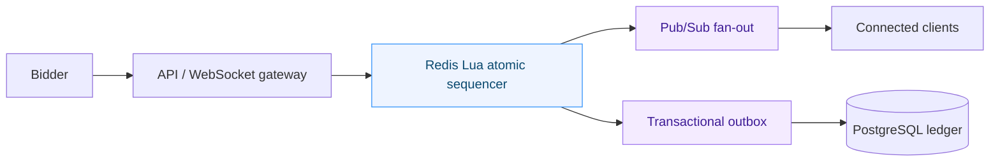

# ⚡ BIDECC

### A cinematic real-time auction experience, built to make concurrency visible.

**Live bidding · Load simulation · Audit ledger · Emergency procurement**

---

## ✨ What is BIDECC?

BIDECC is an interactive front-end laboratory for exploring the difficult part of real-time auctions: accepting the right bid, in the right order, when everyone bids at once. It pairs a premium auction interface with live concurrency simulations, visual telemetry, and a transparent audit trail.

It also includes **Relief Exchange** — a reverse-auction scenario for urgent public procurement, where the best eligible supplier is chosen against price, quantity, certification, budget, and delivery-time constraints.

> **The idea:** real-time marketplaces should feel effortless to participants while remaining demonstrably fair under pressure.

## 🌈 Highlights

| | Capability | What it lets you explore |
|:--:|---|---|
| ⚡ | **Atomic sequencing** | See how a single authoritative sequence prevents stale or out-of-order bid acceptance. |
| 📈 | **Live telemetry** | Watch throughput, latency, acceptance, and violations change under simulated load. |
| 🧪 | **Strategy lab** | Compare naive, pessimistic locking, optimistic CAS, and in-memory sequencer approaches. |
| 🛡️ | **Audit-first design** | Follow every decision through a timestamped transaction ledger. |
| 🚑 | **Relief Exchange** | Model transparent reverse auctions for time-critical emergency supplies. |
| ⏱️ | **Anti-sniping rules** | Extend an auction when valid late bids arrive. |

## 🧠 Concurrency strategies at a glance

## 🗂️ Language mix

The chart below is calculated from first-party source files in this repository (by file size; dependencies and build output excluded).

| JavaScript / JSX | CSS | TypeScript / TSX | Python & HTML |
|:---:|:---:|:---:|:---:|
| `70%` | `24%` | `5%` | `1%` |

## 🧰 Built with

- **React 18** for the interactive experience
- **Vite 5** for fast local development and production builds
- **TypeScript** for the application shell and utilities
- **Lucide React** for crisp UI iconography
- **MP4Box** for scroll-tied video support
- **Tailwind CSS / PostCSS** alongside bespoke visual styling

## 🏛️ Production direction

The demo illustrates a production architecture with a fast, ordered ingest path and asynchronous durability:

The intended invariants are simple and strict:

1. A valid bid must exceed the current high bid by the required increment.
2. Every accepted bid receives a monotonic sequence number.
3. The sequence is authoritative, even if persistence and broadcast complete later.
4. The audit ledger makes the decision trail inspectable.

## 🛣️ Roadmap

- [x] Interactive auction and strategy comparison UI
- [x] Stress-test simulation, telemetry, and audit ledger
- [x] Relief Exchange reverse-auction scenario
- [ ] Connect the sequencer to Redis Lua in a backend service
- [ ] Add PostgreSQL write-behind and transactional outbox
- [ ] Add real WebSocket fan-out and reconciliation
- [ ] Validate with automated multi-region load tests

---

Built for fairer, faster, more transparent real-time markets. ✦

